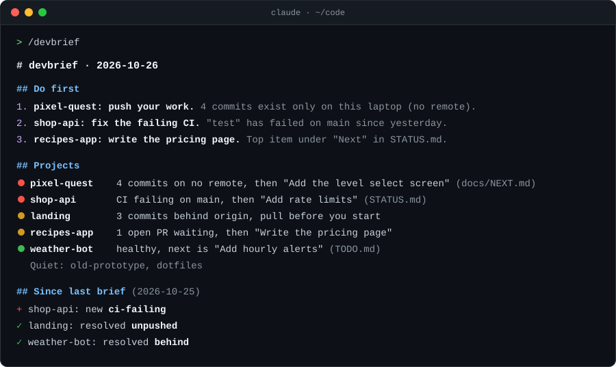

# devbrief

**One command that checks all your projects and tells you what to do next.**

[](https://github.com/WaleedOH/devbrief/actions/workflows/ci.yml)
[](LICENSE)



devbrief is a [Claude Code](https://claude.com/claude-code) skill. A small
collector with no dependencies gathers the facts about every project: git,
GitHub, deploys, databases and your own status docs. Claude then ranks them
and writes a short brief:

- **Do first**: at most three actions you can start right away.
- **Projects**: one line per project, marked red, yellow or green.
- **Since last brief**: problems that appeared or went away.

## Why

If you run several side projects, you lose track of them. Which one is
broken? Which laptop has the latest code? What was the next step?

Dashboards show you status. devbrief tells you **what to do next**, because it
reads the `STATUS.md`, `NEXT.md` and `TODO.md` files you already keep and
quotes their open items.

It also catches **work that exists only on one machine**: commits that are on
no remote branch at all. Those go to the top of the brief, because they are
lost if the laptop dies.

## What it checks

| Source | What it looks at | Needs |
|---|---|---|
| git | branch, ahead/behind origin, commits on no remote, uncommitted files, last commit | git |
| GitHub | open PRs, open issues, latest CI run | [`gh`](https://cli.github.com), logged in |
| Status docs | open items under headings like *Next*, *Left to do*, *Blocked*, plus any `- [ ]` | your own markdown |
| Vercel | latest production deploy, runtime errors (24h) | Vercel MCP connector |
| Supabase | security advisors, sorted into real problems and expected noise | Supabase MCP connector |
| History | what changed since the last brief | nothing |
| Remote mode | the same GitHub and status-doc checks, read from GitHub with no local clones | `gh`, logged in |

Anything that isn't available is skipped and marked "not checked". It never
guesses.

## Install

Requires Node 18+ and git. [`gh`](https://cli.github.com) is optional but
recommended.

### Option 1: plugin marketplace

In Claude Code:

```
/plugin marketplace add WaleedOH/devbrief
/plugin install devbrief@devbrief
```

Plugin skills are namespaced, so you run it as `/devbrief:devbrief` (or just
ask for your brief). Update with `/plugin update devbrief@devbrief`. Pick
one install option: using both gives you two copies of the skill.

### Option 2: manual

```bash
git clone https://github.com/WaleedOH/devbrief.git
cd devbrief
node install.mjs
```

This links the skill into `~/.claude/skills/devbrief` and writes a starter
config at `~/.devbrief/config.json` listing the git repos it found in your
home folder. Run it again to repair the link.

Add `--with-hook` to also install the [auto-pull hook](#auto-pull):

```bash
node install.mjs --with-hook
```

## Usage

In Claude Code:

```
/devbrief            full brief
/devbrief quick      skip Vercel and Supabase
/devbrief offline    don't git fetch
/devbrief my-app     one project in depth
```

You can also just ask "what should I work on?" or "where are all my projects
at?".

Each brief is saved to `~/.devbrief/briefs/<date>.md`, and each snapshot to
`~/.devbrief/snapshots/<date>.json`. The next brief compares against the last
snapshot to fill in "Since last brief".

## Configure

`~/.devbrief/config.json` (see [config.example.json](skills/devbrief/config.example.json)):

```json
{
  "roots": ["~/code"],
  "projects": [
    { "name": "my-app", "path": "~/code/my-app",
      "vercel": { "projectId": "prj_xxx", "teamId": "team_xxx" },
      "supabase": { "projectRef": "abcdefghijklmnop" } },
    { "name": "old-prototype", "path": "~/code/old-prototype",
      "notes": "paused until the launch is done" },
    { "name": "game", "path": "~/code/game",
      "statusDocs": ["docs/NEXT.md", "docs/FIX-LIST.md"] }
  ],
  "exclude": ["dotfiles"],
  "remote": { "owners": ["your-github-user"] }
}
```

- `roots`: folders scanned one level deep for git repos. Default `["~"]`.
- `projects`: explicit projects, or extra settings for discovered ones.
- `notes`: free text about a project that the brief respects. A project noted
  as "paused" or "superseded" gets one short line and never goes in "Do first".
- `statusDocs`: which files to read for next steps, per project or for all.
  The default list is `LAUNCH-STATUS.md`, `STATUS.md`, `NEXT.md`, `TODO.md`,
  `FIX-LIST.md` and `ROADMAP.md`, each at the repo root or in `docs/`.
- `exclude`: project names to skip.
- `remote.owners`: GitHub users or orgs whose repos [remote mode](docs/remote-mode.md)
  checks.
- `staleDays` (default 14), `fetch` (default true), `maxStatusDocs` (default 2).

Vercel is detected from `.vercel/project.json` and Supabase from
`supabase/.temp/project-ref` when they exist, so you rarely need to set them
by hand.

Snapshots and briefs live in `~/.devbrief/`. Override the folder with
`DEVBRIEF_HOME`, or the config file with `DEVBRIEF_CONFIG`.

## Run it on a schedule

Remote mode collects from GitHub only, with no local clones, so it can run as
a scheduled cloud job and have a brief ready before you sit down. See
[docs/remote-mode.md](docs/remote-mode.md).

Remote mode cannot see uncommitted files or commits that exist only on one
machine. The local brief is still the one that catches those.

## Auto-pull

With `node install.mjs --with-hook`, a Claude Code SessionStart hook
fast-forwards your clean repos when a session starts. Repos with uncommitted
changes or diverged branches are left alone, and it gives up after 20
seconds so a session never hangs. `node install.mjs --remove-hook` takes it
out. To see what is behind without changing anything:

```bash
node skills/devbrief/scripts/pull.mjs --dry-run
```

See [docs/auto-pull.md](docs/auto-pull.md).

## Privacy

Everything stays on your machine. devbrief has no server, no account and no
telemetry. The only network calls are the ones you'd make anyway: `git fetch`,
`gh` and the MCP connectors you already have in Claude Code.

## The collector on its own

```bash
node skills/devbrief/scripts/collect.mjs --no-fetch | jq '.projects[].flags'
```

It prints a JSON snapshot, so you can use it from scripts, CI or other agents.
Other flags: `--project <name>`, `--no-save`, `--init`, `--config <file>`.

## Development

```bash
npm test
```

No dependencies, only Node's built-in test runner. See
[CONTRIBUTING.md](CONTRIBUTING.md) and the [changelog](CHANGELOG.md).

## License

[MIT](LICENSE) © WaleedOH
