# devbrief

**Wake up to draft PRs and a brief that tells you what to do first.**

[](https://github.com/WaleedOH/devbrief/actions/workflows/ci.yml)
[](LICENSE)
[](https://github.com/WaleedOH/devbrief/releases)


<p align="center">
  
</p>

devbrief is a [Claude Code](https://claude.com/claude-code) plugin for people
with more projects than attention. One command checks every repo you have
(git, GitHub, deploys, databases and your own status docs) and tells you the
three things to do first. Overnight, it can fix the safe ones and leave draft
PRs for you to review.

- **Do first**: at most three actions you can start right away, ranked.
- **Projects**: one line per project, red, yellow or green, with its next step.
- **Night shift**: draft PRs opened while you slept. Never merged, never on main.
- **Since last brief**: problems that appeared or went away.

```
/plugin marketplace add WaleedOH/devbrief
/plugin install devbrief@devbrief
/devbrief:devbrief demo
```

## Try it in 10 seconds

After installing, run this in Claude Code:

```
/devbrief:devbrief demo
```

(`/devbrief demo` with a manual install.) It shows a sample brief for a
made-up developer with five projects: no setup, no config, nothing read from
your machine. Then ask for `review`, `nightshift` or `post` to see the other
samples. When you're ready, run `/devbrief` for your own projects; it finds
the git repos in your home folder on its own.

## Why

If you run several side projects, you lose track of them. Which one is
broken? Which laptop has the latest code? What was the next step?

Dashboards show you status. devbrief tells you **what to do next**, because it
reads the `STATUS.md`, `NEXT.md` and `TODO.md` files you already keep and
quotes their open items.

It also catches **work that exists only on one machine**: commits that are on
no remote branch at all. Those go to the top of the brief, because they are
lost if the laptop dies.

## What it checks

| Source | What it looks at | Needs |
|---|---|---|
| git | branch, ahead/behind origin, commits on no remote, uncommitted files, last commit | git |
| GitHub | open PRs, open issues, latest CI run | [`gh`](https://cli.github.com), logged in |
| Status docs | open items under headings like *Next*, *Left to do*, *Blocked*, plus any `- [ ]` | your own markdown |
| Vercel | latest production deploy, runtime errors (24h) | Vercel MCP connector |
| Supabase | security advisors, sorted into real problems and expected noise | Supabase MCP connector |
| History | what changed since the last brief | nothing |
| Remote mode | the same GitHub and status-doc checks, read from GitHub with no local clones | `gh`, logged in |

Anything that isn't available is skipped and marked "not checked". It never
guesses.

## Install

Requires Node 18+ and git. [`gh`](https://cli.github.com) is optional but
recommended.

### Option 1: plugin marketplace

In Claude Code:

```
/plugin marketplace add WaleedOH/devbrief
/plugin install devbrief@devbrief
```

Plugin skills are namespaced, so you run it as `/devbrief:devbrief` (or just
ask for your brief). Update with `/plugin update devbrief@devbrief`. Pick
one install option: using both gives you two copies of the skill.

### Option 2: manual

```bash
git clone https://github.com/WaleedOH/devbrief.git
cd devbrief
node install.mjs
```

This links the skill into `~/.claude/skills/devbrief` and writes a starter
config at `~/.devbrief/config.json` listing the git repos it found in your
home folder. Run it again to repair the link.

Add `--with-hook` to also install the [auto-pull hook](#auto-pull):

```bash
node install.mjs --with-hook
```

## Usage

In Claude Code:

```
/devbrief                 full brief
/devbrief quick           skip Vercel and Supabase
/devbrief offline         don't git fetch
/devbrief my-app          one project in depth
/devbrief 40m             only what fits in 40 minutes
```

You can also just ask "what should I work on?" or "where are all my projects
at?".

Each brief is saved to `~/.devbrief/briefs/<date>.md`, and each snapshot to
`~/.devbrief/snapshots/<date>.json`. The next brief compares against the last
snapshot to fill in "Since last brief", and tells you how long each next step
has been waiting: *"Add login" (next for 6 days)*.

## Beyond the brief

| Command | What it does | Docs |
|---|---|---|
| `/devbrief do 1` | Carries out item 1 of today's "Do first", safely: risky steps ask first, code changes go on a branch. | [nightshift.md](docs/nightshift.md) |
| `/devbrief nightshift` | While you sleep, picks safe tasks in projects you opted in, fixes them in isolated worktrees and opens **draft** PRs. Never merges, never pushes to your main branch, never touches work in progress. Your morning brief opens with "Night shift: 3 draft PRs ready for review". | [nightshift.md](docs/nightshift.md) |
| `/devbrief fix-everywhere` | Finds the same problem in several projects and fixes it once for all of them. | [nightshift.md](docs/nightshift.md) |
| `/devbrief wrap` | Ends a session by updating the repo's status doc from what you did. With the hook installed, Claude nudges you when you commit without updating it. | [living-docs.md](docs/living-docs.md) |
| `/devbrief review` | Weekly portfolio review: where your time went, launch distance, stars and (opt-in) traffic and sign-ups, and a push / pause / kill / finish call per project. | [review.md](docs/review.md) |
| `/devbrief send` | Sends the brief to your phone (ntfy, free, no account), Discord or a desktop notification. | [deliver.md](docs/deliver.md) |
| `/devbrief speak` | Reads a 60-second version out loud with your computer's built-in voice. | [deliver.md](docs/deliver.md) |
| `/devbrief resume` | Switched laptops? Shows what you were in the middle of on the other one, through a private GitHub repo you own. | [resume.md](docs/resume.md) |
| `/devbrief post` | Turns the week's work into a draft X thread, LinkedIn post or devlog. Private projects stay private; nothing is posted for you. | [post.md](docs/post.md) |

## Use it from any agent (MCP)

devbrief includes a small MCP server with no dependencies, so Claude Code,
Claude Desktop or any other MCP client can read your briefs. Its five tools
are read-only: `devbrief_latest`, `devbrief_project`, `devbrief_collect`,
`devbrief_brief` and `devbrief_review`.

The plugin registers it for you. With a manual install:

```bash
claude mcp add --scope user devbrief -- node /path/to/devbrief/skills/devbrief/mcp/server.mjs
```

For other clients and the JSON config, see [docs/mcp.md](docs/mcp.md).

## Configure

`~/.devbrief/config.json` (see [config.example.json](skills/devbrief/config.example.json)):

```json
{
  "roots": ["~/code"],
  "projects": [
    { "name": "my-app", "path": "~/code/my-app",
      "vercel": { "projectId": "prj_xxx", "teamId": "team_xxx" },
      "supabase": { "projectRef": "abcdefghijklmnop" } },
    { "name": "old-prototype", "path": "~/code/old-prototype",
      "notes": "paused until the launch is done" },
    { "name": "game", "path": "~/code/game",
      "statusDocs": ["docs/NEXT.md", "docs/FIX-LIST.md"] }
  ],
  "exclude": ["dotfiles"],
  "remote": { "owners": ["your-github-user"] }
}
```

- `roots`: folders scanned one level deep for git repos. Default `["~"]`.
- `projects`: explicit projects, or extra settings for discovered ones.
- `notes`: free text about a project that the brief respects. A project noted
  as "paused" or "superseded" gets one short line and never goes in "Do first".
- `statusDocs`: which files to read for next steps, per project or for all.
  The default list is `LAUNCH-STATUS.md`, `STATUS.md`, `NEXT.md`, `TODO.md`,
  `FIX-LIST.md` and `ROADMAP.md`, each at the repo root or in `docs/`.
- `exclude`: project names to skip.
- `remote.owners`: GitHub users or orgs whose repos [remote mode](docs/remote-mode.md)
  checks.
- `staleDays` (default 14), `fetch` (default true), `maxStatusDocs` (default 2).

Vercel is detected from `.vercel/project.json` and Supabase from
`supabase/.temp/project-ref` when they exist, so you rarely need to set them
by hand.

Snapshots and briefs live in `~/.devbrief/`. Override the folder with
`DEVBRIEF_HOME`, or the config file with `DEVBRIEF_CONFIG`.

## Run it on a schedule

Remote mode collects from GitHub only, with no local clones, so it can run as
a scheduled cloud job and have a brief ready before you sit down. See
[docs/remote-mode.md](docs/remote-mode.md).

Remote mode cannot see uncommitted files or commits that exist only on one
machine. The local brief is still the one that catches those.

## Hooks: auto-pull and session tracking

With `node install.mjs --with-hook`, devbrief adds three Claude Code hooks: one
that fast-forwards your clean repos when a session starts, and two that notice
when a session made commits without updating the status doc (see
[living-docs.md](docs/living-docs.md); turn the nudge off with
`"wrap": { "nudge": false }`).

The auto-pull hook fast-forwards your clean repos when a session starts. Repos with uncommitted
changes or diverged branches are left alone, and it gives up after 20
seconds so a session never hangs. `node install.mjs --remove-hook` takes it
out. To see what is behind without changing anything:

```bash
node skills/devbrief/scripts/pull.mjs --dry-run
```

See [docs/auto-pull.md](docs/auto-pull.md).

## Safety

devbrief reads by default and asks before anything risky.

- **The brief only reads.** It runs `git fetch`, `gh` and read-only MCP calls,
  and never changes a repo.
- **The night shift is opt-in per project** (`"nightShift": true`). It works
  in a separate worktree from `origin`, never in your working copy, and skips
  any repo with uncommitted or unpushed work. It opens **draft** PRs only:
  it never merges, never pushes to your default branch, never force-pushes,
  and never touches secrets, env files, deploy config or migrations it would
  apply. If the tests aren't green, it opens no PR and tells you why. Turn on
  branch protection for the real guarantee.
- **`/devbrief do`** carries out pulls, branch pushes and test runs itself.
  Pushing to main, deleting branches, deploys and database writes need your
  explicit yes.
- **Auto-pull** only fast-forwards clean repos that are behind. It never
  merges, rebases or touches a repo with local changes.

## Privacy

Everything stays on your machine. devbrief has no server, no account and no
telemetry. The only network calls are the ones you'd make anyway: `git fetch`,
`gh` and the MCP connectors you already have in Claude Code. The optional
features that send data elsewhere are off until you set them up, and only go
where you point them: `send` (your ntfy topic or Discord webhook, read from
environment variables), `resume` (a private GitHub repo you own; it refuses
public ones and never stores file contents) and `nightshift` (draft PRs in
your own repos).

## The collector on its own

```bash
node skills/devbrief/scripts/collect.mjs --no-fetch | jq '.projects[].flags'
```

It prints a JSON snapshot, so you can use it from scripts, CI or other agents.
Other flags: `--project <name>`, `--no-save`, `--init`, `--config <file>`.

## Development

```bash
npm test
```

No dependencies, only Node's built-in test runner. See
[CONTRIBUTING.md](CONTRIBUTING.md) and the [changelog](CHANGELOG.md).

## License

[MIT](LICENSE) © WaleedOH
